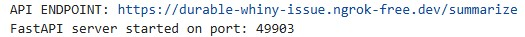
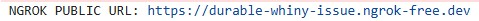
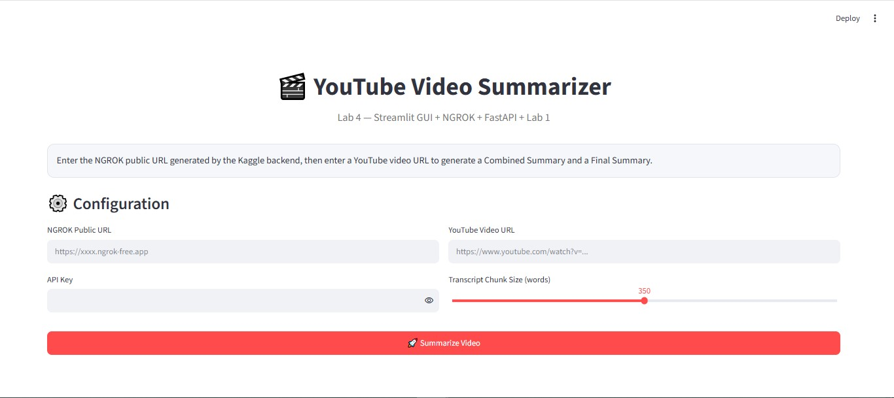
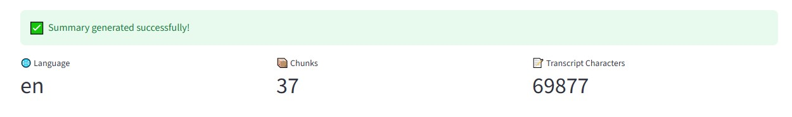
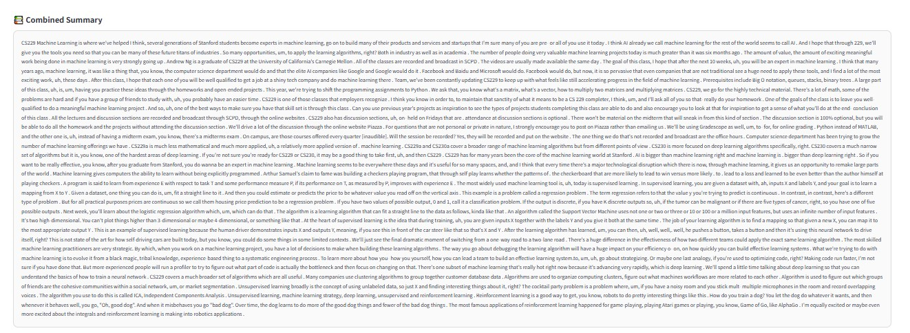
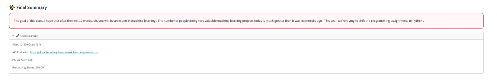

# 🎬 YouTube Video Summarizer — Lab 4

## Overview

This project rebuilds **Lab 1 — YouTube Video Summarizer** as a client/server application using **Kaggle**, **FastAPI**, **NGROK**, and **Streamlit**.

The Lab 1 summarization workflow is preserved and extended with a public API and a local graphical interface.

## Architecture

```text
Local PC
┌──────────────────────┐
│    Streamlit GUI     │
│ YouTube URL + Key    │
└──────────┬───────────┘
           │ HTTPS POST
           ▼
┌──────────────────────┐
│      NGROK URL       │
│   Public HTTPS       │
└──────────┬───────────┘
           ▼
┌──────────────────────┐
│    Kaggle Backend    │
│ FastAPI + Lab 1      │
│                      │
│ Transcript           │
│ Language Detection   │
│ Chunking             │
│ Chunk Summaries      │
│ Combined Summary     │
│ Final Summary        │
└──────────────────────┘
```

## Project Structure

```text
Youtube_Summarize_Task_Using_NGROK_&_Streamlit/
│
├── Lab4_NGROK_Kaggle_YouTube_Summarizer.ipynb
├── streamlit_app.py
├── requirements.txt
├── README.md
│
├── screenshots/
│   ├── kaggle_backend.jpg
│   ├── ngrok_url.jpg
│   ├── streamlit_interface.jpg
|   ├── final_result_1.jpg
|   ├── final_result_combined_summary.jpg
│   └── final_result_final_summary_and_technical_details.jpg
│
└── demo_video/
    └── Lab4_Using_NGROK_&_Streamlit_For_YouTube_Summarizer.webm
```

## Requirements

### Kaggle

The notebook installs:

```bash
pip install -q youtube-transcript-api transformers sentencepiece arabert langdetect fastapi uvicorn pyngrok accelerate
```

### Local PC

```powershell
python -m pip install -r requirements.txt
```

Run Streamlit with:

```powershell
python -m streamlit run streamlit_app.py
```

## Running the Project

### 1. Start Kaggle Backend

Open `Lab4_NGROK_Kaggle_YouTube_Summarizer.ipynb` and run it from the beginning.

The notebook loads the Arabic and English models, starts FastAPI, creates the NGROK tunnel, and prints the public URL.

Example output:

```text
NGROK PUBLIC URL: https://xxxx.ngrok-free.app
API ENDPOINT: https://xxxx.ngrok-free.app/summarize
FastAPI server started on port: 12345
```

Keep the Kaggle session running while using Streamlit.

### 2. Start Streamlit

From the project directory:

```powershell
python -m streamlit run streamlit_app.py
```

Open the local address shown by Streamlit, normally:

```text
http://localhost:8501
```

### 3. Enter the Data

Enter:

- NGROK Public URL
- API Key
- YouTube Video URL
- Transcript chunk size

Then click **Summarize Video**.

## Processing Pipeline

```text
YouTube URL
      ↓
Video ID
      ↓
Transcript
      ↓
Clean Transcript
      ↓
Language Detection
      ↓
Split into Chunks
      ↓
Summarize Each Chunk
      ↓
Combined Summary
      ↓
Final Summary
      ↓
HTTP 200 OK
      ↓
Streamlit displays result
```

## Combined Summary

The Combined Summary is created by joining all chunk summaries:

```text
Chunk Summary 1 + Chunk Summary 2 + ... + Chunk Summary N
```

It is an intermediate representation of the video and is displayed separately in Streamlit.

## Final Summary

The Final Summary is generated by summarizing the Combined Summary one additional time.

This produces a shorter consolidated summary and is displayed separately from the Combined Summary.

## API

### Endpoint

```text
POST /summarize
```

### Authorization

```text
Authorization: Bearer YOUR_API_KEY
```

### Request

```json
{
  "youtube_url": "https://www.youtube.com/watch?v=VIDEO_ID",
  "max_words": 350
}
```

### Response

```json
{
  "video_id": "VIDEO_ID",
  "language": "en",
  "transcript_characters": 69877,
  "chunk_count": 37,
  "combined_summary": "...",
  "summary": "..."
}
```

## Models

### Arabic

`malmarjeh/mbert2mbert-arabic-text-summarization`

Arabic preprocessing uses `ArabertPreprocessor` and the model is called directly with `generate()`.

### English

`sshleifer/distilbart-cnn-12-6`

The current implementation runs the English model on CPU for compatibility with the environment used in Lab 1/Lab 4.

## Streamlit Interface

The Streamlit GUI provides:

- Clean project title and description
- NGROK URL input
- Protected API-key input
- YouTube URL input
- Chunk-size slider
- Processing spinner
- Language, chunk count, and transcript-size metrics
- Combined Summary section
- Final Summary section
- Technical Details section

## Security
```python
NGROK_TOKEN = "PUT_YOUR_NEW_NGROK_TOKEN_HERE"
API_KEY = "PUT_YOUR_API_KEY_HERE"
```

## Evidence

# 📸 Screenshots

Adding screenshots to `screenshots/` showing:

1. Kaggle backend running.
2. NGROK public URL.
3. Streamlit interface.
4. Combined , Final Summary and Technical Details results.


The project details can be demonstrated through the following screenshots :

## Kaggle Backend.jpg



## Ngrok Url



## Streamlit Interface



## Final Result





# 🎥 Demo

A screen recording demonstrating the rebuilding of Lab 1 : Youtube Vedio Summarization using NGROK and streamlit.

[▶️ Watch the Demo](demo_video/Lab4_Using_NGROK_&_Streamlit_For_YouTube_Summarizer.webm)

OR

[▶️ Watch the Demo](https://drive.google.com/drive/folders/1iPKOBkjWNqIfn3vhLyRraYuKl4facvvJ?usp=sharing)

Adding the final demonstration recording to `demo_video/`.

## Objective

The task extends the original Lab 1 YouTube summarizer into a distributed application where:

- Kaggle performs the heavy AI processing.
- FastAPI exposes the summarization service.
- NGROK connects the remote Kaggle backend to the local machine.
- Streamlit provides the user interface.

## Author

**Andrew Sameh**

**Built as part of Tips Hindawi Internship — Lab 4**
